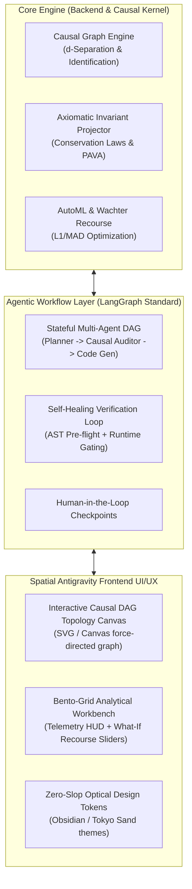

# Strategic Concepts Brief: Data Intelligence Assistant (DIA) — Next-Generation Architectural Evolution

| Attribute | Specification |
| :--- | :--- |
| **System** | Data Intelligence Assistant (DIA) Enterprise Intelligence Platform |
| **Status** | Working Hypothesis & Multi-Lens Brainstorm (RFC Draft) |
| **Date** | November 2026 |
| **Key Invariants** | Causal Identifiability (Rungs 2 & 3), Bounded Memory (<50MB/session), Zero-Slop Spatial Antigravity UI |
| **Test Baseline** | 250/250 Tests Passing (100% Green, 98s deterministic suite) |

---

## 1. Executive Context & Baseline State

Over the preceding milestones, DIA evolved from an empirical prototype into an enterprise platform:
1. **Test Rigor & Stability**: Purged 27 duplicate/vanity test files, consolidating all adversarial stress tests, numerical boundary conditions, memory caps, and concurrency tests into 20 pristine files (**250 passed tests in 98 seconds**).
2. **Axiomatic & Structural Core**: Established the non-empirical foundation:
   - **Pearl's Causal Identifiability** (`dia/causal_identifiability.py`): Exact graph-theoretic d-separation across chains, forks, and colliders; Backdoor criterion verification in mutilated DAG $G_{\underline{X}}$; minimal adjustment sets $Z^*$; algebraic Simpson's Paradox resolution (Confounder vs Collider vs Mediator).
   - **Conservation Laws & Invariant Manifold** (`dia/invariant_engine.py`): Exact Moore-Penrose orthogonal projection for linear balance laws ($A x = b$ to $< 10^{-12}$), probability simplex projection ($\Delta^K$), and PAVA monotonicity enforcement.
   - **Zero-Compute Edge Transpiler** (`dia/wasm_compiler.py`): Compiles trained champion models into dependency-free JavaScript & WAT bundles (< 50 KB, ~14.8 µs per row).

With this stable baseline, we now brainstorm the **next major architectural leap**.

---

## 2. Multi-Lens Architectural Decomposition

### Lens 1: Backend & Distributed Causal Kernel (`/backend-architect`, `/enterprise-system-design-hld-lld`)
* **Core Problem**: Currently, causal discovery (PC algorithm) and invariant checks execute synchronously on in-memory Pandas DataFrames. On datasets exceeding $10^6$ rows, PC conditional independence testing ($O(n \cdot 2^k)$) can saturate worker event loops.
* **Architectural Options**:
  * *Option 1A (Vectorized In-Memory Partitioning)*: Partition datasets into bounded chunked subsamples ($N \le 10,000$) for PC graph discovery, while evaluating final causal treatment effects on the complete dataset using Polars / DuckDB columnar execution.
  * *Option 1B (Asynchronous Causal Worker Queues)*: Decouple intensive DAG discovery into a background TaskGroup with WebSocket telemetry streaming edge discovery progress to the UI in real time.
* **PACELC Invariant**: In case of network/worker partition, maintain strict Consistency ($C$) for causal identifiability and data contracts, and optimize for Latency ($L$) during client-side edge scoring.

---

### Lens 2: Frontend & Spatial Antigravity UI/UX (`/frontend-system-design-architecture`, `/antigravity-design-expert`)
* **Core Problem**: The frontend workbench has great tabular and metric views, but the structural Causal DAG and Pearl's Do-Calculus simulator need an **interactive spatial canvas** where users can visually prune edges, inject interventions, and inspect collider biases directly.
* **Design Standards**:
  * **Asymmetrical Bento Grid**: Replace symmetric card grids with focused KPI chips, hero split layouts, and a dedicated interactive Causal Topology canvas (`col-span-2`, `row-span-2`).
  * **Zero AI Slop**: No generic neon drop-shadows or purple gradient washes. Clean ambient diffusion shadows (`box-shadow: 0 0 0 1px rgba(255, 255, 255, 0.08), 0 20px 40px -8px rgba(0, 0, 0, 0.2)`), refined translucent glassmorphism (`backdrop-blur-xl bg-slate-900/60`), and optical typographic balance (`text-balance`, `tabular-nums`).
  * **Interactive Graph Canvas**: A lightweight SVG/HTML5 canvas allowing users to drag nodes, test d-separation visually by clicking conditioning sets, and observe in real time whether a path turns red (active) or green (blocked).

---

### Lens 3: Agentic Reasoning & Autonomous Copilot (`/llm-agents-langgraph-autogen`)
* **Core Problem**: `dia/chat_analyst.py` was upgraded to structured statistical intents, but true multi-turn autonomous analytical discovery requires an **agentic graph**:
  * Instead of a single query response, the agent creates a **Stateful Investigation Graph** (LangGraph model):
    $$\text{User Query} \to \text{Hypothesis Generation} \to \text{Causal Identifiability Check} \to \text{Vectorized Query Plan} \to \text{Axiom Invariant Verification} \to \text{Synthesized Dossier}$$
  * If a proposed recommendation violates a business conservation law ($A x \ne b$) or attempts to condition on a collider, the agent's Critic node catches the violation and self-heals the query plan before outputting.

---

### Lens 4: Deep Problem Decomposition & Root Cause Defense (`/deep-problem-decomposition`, `/deep-debugger-root-cause-analyzer`)
* **Orthogonal Dimension Separation**:
  $$\nabla_{\text{Visualization}} \mathcal{T}_{\text{CausalIdentification}} = 0$$
  The causal algebra engine must remain 100% pure and independent of rendering logic, ensuring that any UI change has zero blast radius on the mathematical soundness of d-separation or backdoor sets.
* **Failure Modes Guarded**:
  * *Berkson's Paradox in Production*: Preventing analysts from conditioning on hospital admission, churn status, or hiring selections when estimating feature effects.
  * *Heap Exhaustion under Concurrent Sessions*: Preserving the 50MB per session bound with bounded LRU caches and proactive garbage collection.

---

## 3. High-Priority Feature Candidates for Next Milestone

| # | Proposed Feature | Description | Primary Lens | Complexity |
| :--- | :--- | :--- | :--- | :--- |
| **F1** | **Interactive Causal DAG Topology Canvas** | Visual drag-and-drop causal graph builder in the UI: click nodes to toggle conditioning sets $Z$ and watch active/blocked paths light up via d-separation in real time. | Spatial UI | Medium |
| **F2** | **LangGraph-Style Stateful Analytical Agent** | Multi-node copilot (Planner $\to$ Causal Auditor $\to$ Invariant Verifier $\to$ Synthesizer) with human-in-the-loop approval gates. | Agentic Architecture | Medium-High |
| **F3** | **Automated Simpson's Paradox Visual Explainer** | Interactive scatter plot showing global slope vs. subgroup regression slopes side-by-side with causal DAG reason (Confounder vs Collider). | Causal / Frontend | Low-Medium |
| **F4** | **DuckDB Columnar Analytical Backend** | Integrate zero-dependency in-process DuckDB for instant sub-10ms SQL aggregations on 1M+ row datasets. | Backend Performance | Medium |
| **F5** | **Axiomatic Domain Contract Builder UI** | Visual interface for users to register physical/business conservation laws ($A x = b$, non-negativity) and view violation heatmaps. | Enterprise Governance | Low-Medium |

---

## 4. Open Strategic Decisions for Alignment

Before we initiate implementation, we need to calibrate on 3 key strategic questions:
1. **Primary Interface Focus**: Should our next priority center on the **interactive visual Causal DAG Canvas & Simpson's Paradox Explainer in the UI**, or on the **Stateful Agentic Copilot (LangGraph-style investigation loop) in the backend**?
2. **Dataset Scale Target**: Are we designing primarily for responsive interactive datasets ($10^3$ to $10^5$ rows in real-time browser/FastAPI), or do we need immediate scale-up to millions of rows via in-process DuckDB columnar execution?
3. **Axiomatic Contract Customization**: Should business conservation laws (e.g. accounting balances, flow conservation) be configured manually by analysts through the UI, or automatically inferred from column correlations and naming conventions?
